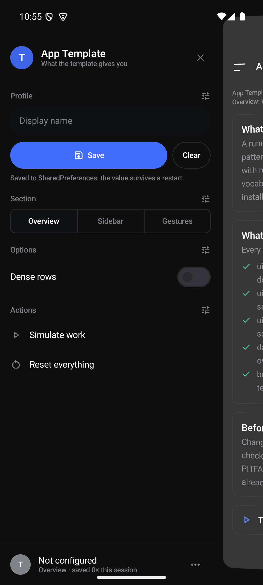
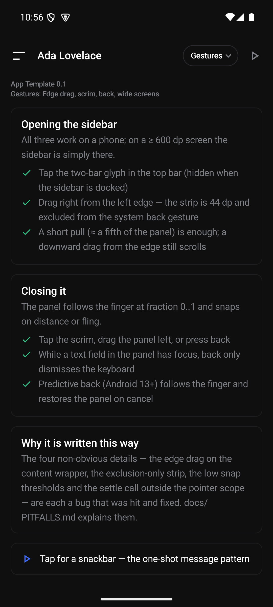
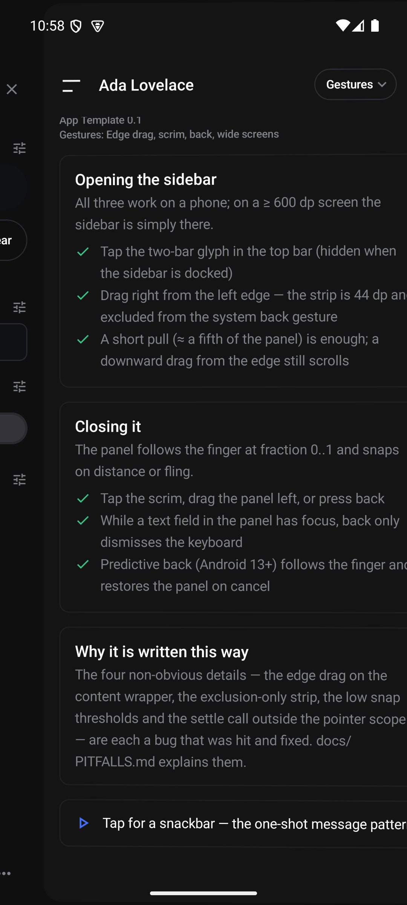
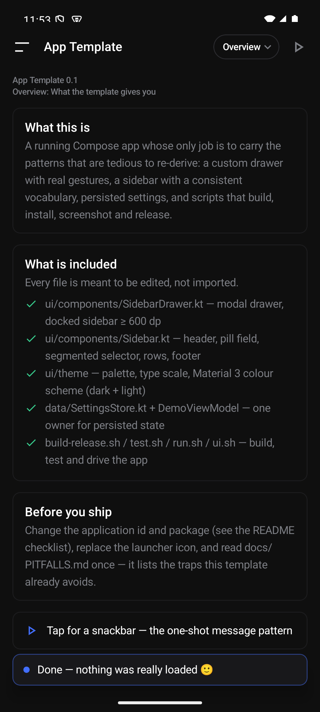

# android-app-template

A **running** Jetpack Compose Android app whose job is to carry the patterns that are
tedious to re-derive — above all a **sidebar** in a custom drawer with real gestures.
Clone it, rename it, replace the content; keep the parts that were expensive to get right.

Verified on a Pixel 7 API 34 emulator: `./test.sh` builds, installs, launches and
screenshots it, and `./build-release.sh` produces a signed, verified release APK.

| sidebar | content |
|---|---|
|  |  |

Mid-drag (captured with `./ui.sh drag-shot`), showing the panel following the finger and the
content behind it fading, scaling and taking a rounded corner:



A one-shot message in the app's own snackbar — the card radius, hairline and surface fill of
everything else, not Material's light-grey slab (see `ui/components/AppSnackbar.kt`):



## What is in the box

| path | what it gives you |
|---|---|
| `ui/components/SidebarDrawer.kt` | the drawer: finger-following panel, scrim, white wash + scale/rotation on the content, edge-swipe to open, drag/tap to close, predictive back, and a **docked sidebar ≥ 600 dp** |
| `ui/components/Sidebar.kt` | the sidebar vocabulary: brand header, group labels, pill text field, segmented selector, switch row, action rows, account-row footer with overflow menu |
| `ui/components/Animations.kt` | shimmer brush, `AppearIn` (fade + slide), pulsing dot — no Lottie, no extra dependencies |
| `ui/components/AppSnackbar.kt` | the app's own snackbar (`AppSnackbarHost`) — card radius, hairline, surface fill and a brand dot, instead of Material's light-grey `inverseSurface` slab; one call in the `Scaffold` |
| `ui/theme/` | palette, type scale and the Material 3 colour schemes (dark + light) |
| `ui/icons/DrawerIcons.kt` | the two-bar drawer glyph (everything else uses `Icons.Outlined.*`) |
| `data/SettingsStore.kt` | persisted settings in one place (`SharedPreferences` behind a typed API) |
| `DemoViewModel.kt` | the state holder: one `StateFlow`, one-shot messages, suspend work |
| `TemplateApp.kt` | the shell: drawer host + top bar (menu glyph, title, actions chip) + content list |
| `test.sh` `run.sh` `ui.sh` `build-release.sh` | the whole loop: test, drive by hand or by script, release |
| `docs/PITFALLS.md` | **read this once** — the traps this template already avoids, each one a bug that was hit |
| `shots/` | reference screenshots of the demo |

The demo content itself (the three "sections" of text cards) is throwaway — that is the
part you replace.

## Quick start

```bash
# 1. one-time: point the build at an SDK (or set ANDROID_HOME)
echo "sdk.dir=$HOME/.android-sdk" > local.properties

# 2. build, install on an emulator/device, launch, screenshot
./test.sh

# 3. look at it with a window and click around
./run.sh
```

Gradle is looked for in `$GRADLE_BIN`, on `PATH`, at `./gradlew`, then at
`~/tools/gradle-*/bin/gradle`. Versions: AGP 8.13.0 / Kotlin 2.2.20 / Compose BOM
2025.09.00 / Gradle 8.13 — verified together. `minSdk 32`, `targetSdk 36`.

If you prefer the IDE, open the folder in Android Studio; nothing here depends on a
wrapper, so also run *File → Sync* once to generate one if you want `./gradlew`.

## The test loop

`./test.sh` is the whole cycle in one command. It boots a headless emulator if none is
attached (and leaves it running — boot is the slow part), builds, installs, launches and
screenshots to `shots/check.png`.

```bash
./test.sh                     # build + install + launch + shot
./test.sh --no-build          # reuse the current debug APK (fastest iteration)
./test.sh --cold              # force-stop first, i.e. test a cold start
LOG=1 SETTLE=6 ./test.sh      # wait longer before the shot + dump a filtered logcat tail
AVD=pixel7_api34 ./test.sh    # pick the AVD
```

It reads `namespace` from `app/build.gradle.kts`, so renaming the app does not mean editing
the scripts. Override with `APP_ID=… ACTIVITY=…` if you move `MainActivity`.

### Driving the app

`./ui.sh` drives the running app through the accessibility tree, so targets are **named**,
not guessed from pixels:

```bash
./ui.sh here                       # every text/content-desc on screen + its centre
./ui.sh tap "Open sidebar"         # by text or content-desc
./ui.sh tap 74 220                 # or raw pixels
./ui.sh field 0 "Ada Lovelace"     # clear the top-most text field, then type
./ui.sh key BACK                   # or ENTER, or 4
./ui.sh swipe 540 1800 540 600 300
./ui.sh drag-shot shots/x.png 380 900 720 900   # screenshot DURING a gesture
./ui.sh ime off                    # hide the keyboard
./ui.sh shot shots/x.png
```

`drag-shot` exists because `adb shell input swipe` only returns when the gesture is over —
a pressed state, a crosshair or a half-open drawer can only be photographed from a second
process while the swipe runs.

### Manual testing

`./run.sh` opens the emulator **with a window**, installs and launches the app, then leaves
it to you (`SCALE=0.75 ./run.sh`, `GPU=host ./run.sh`, `./run.sh --no-build`,
`./run.sh --kill`). Two environment facts it works around are in `docs/PITFALLS.md`
("Emulator and scripts").

## Building a release

```bash
./build-release.sh                 # signed release APK + com.example.template-0.1-Release.apk
./build-release.sh --clean         # wipe build/ first
./build-release.sh --bundle        # also produce the .aab for Play
./build-release.sh --install       # build, then install + launch on the connected device
./build-release.sh --debug         # debug variant instead
```

The first run **generates `release.keystore` + `keystore.properties`** (both git-ignored,
`600`, random password unless `KS_PASSWORD` is set). The script then builds, copies the APK
to `<applicationId last segment>-<version>-Release.apk`, prints size and SHA-256, and
**verifies the signature with `apksigner`** rather than assuming it.

> Keep `release.keystore` and `keystore.properties` safe and out of the repo. They are the
> app's identity: Play refuses an update signed with a different key, and losing them means
> you can never update the app that is already installed.

Useful Gradle tasks directly:

```bash
gradle :app:assembleDebug          # app/build/outputs/apk/debug/app-debug.apk
gradle :app:installDebug           # build + install on the connected device
gradle :app:assembleRelease        # needs keystore.properties, else unsigned
gradle :app:bundleRelease          # .aab for Play
```

## Making it your app (checklist)

1. **Package**: rename `com.example.template` in `app/src/main/java/...` (Android Studio:
   *Refactor → Rename*) and set `namespace` **and** `applicationId` in
   `app/build.gradle.kts`. Keep them literal: the scripts read `namespace` from that file.
2. **Name**: `app/src/main/res/values/strings.xml` (`app_name`) and `settings.gradle.kts`
   (`rootProject.name`).
3. **Icon**: replace `app/src/main/res/drawable/ic_launcher_foreground.xml` (keep the art
   inside the central 72×72 safe zone of the 108×108 viewport) and pick the background in
   `values/ic_launcher_background.xml`. `mipmap-anydpi-v26` needs no per-density PNGs at
   `minSdk 32`.
4. **Theme**: `ui/theme/Color.kt` is the single source of colour; `Type.kt` for the type
   scale; `res/values/themes.xml` and `colors.xml` for the window background (keep it in
   sync with the palette or the first frame flashes white in dark mode).
5. **Versions**: `versionCode`/`versionName` in `app/build.gradle.kts`; turn on
   `isMinifyEnabled`/`isShrinkResources` for the release build and re-test on a device when
   you do.
6. **Content**: delete the demo cards in `TemplateApp.kt` (`DemoSection.cards()`), the
   demo fields in `SettingsStore`, and start from `MainActivity` → `TemplateApp` →
   your own screen. Keep `docs/PITFALLS.md` — it is the point of the template.
7. **Remove what you do not need**: the `INTERNET` permission in the manifest.

## Library versions

```kotlin
AGP           8.13.0
Kotlin        2.2.20        // and org.jetbrains.kotlin.plugin.compose — must match exactly
Compose BOM   2025.09.00
Gradle        8.13
compileSdk 36 / minSdk 32 / targetSdk 36 / JVM 17
```

Bump Kotlin and the Compose compiler plugin together; the compiler ships with Kotlin now,
so a mismatch is a build failure with a confusing message. No other third-party
dependencies are used on purpose — the template must keep building when something in the
ecosystem breaks.

## Next steps

`docs/PITFALLS.md` — **the four drawer bugs, the back/keyboard interaction, the insets, the
emulator quirks and the Compose gotchas**, each with the symptom you would see and the fix
that is already in this code. Read it before changing `SidebarDrawer.kt`, and before you
conclude that something in the template "does not work".
